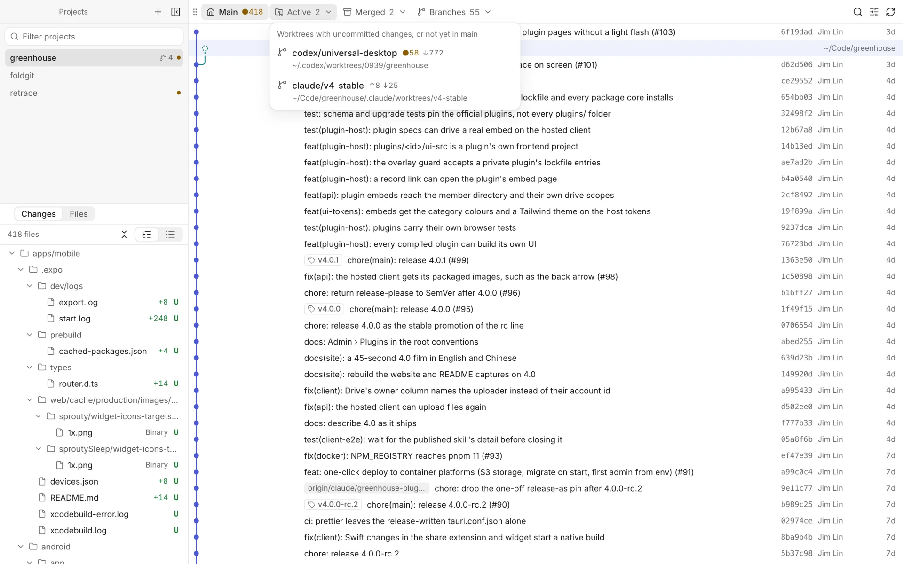
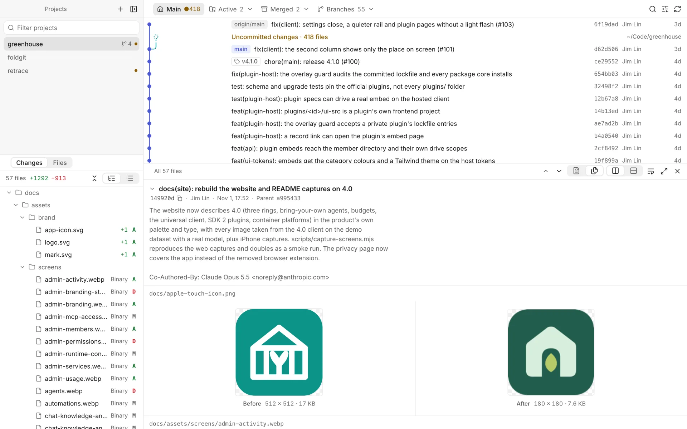
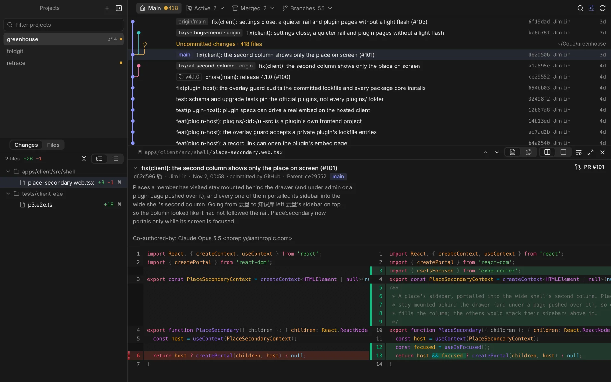

# Retrace

**A read-only desktop app for reviewing Git history across many repositories — built for the age of coding agents.**

Agents now write code in a dozen worktrees at once. Retrace puts every project, worktree and branch in one window, keeps your integration branch pinned to the left of the commit graph, and lets you read each commit's message and diff, or browse the code as it was at any commit. It never commits, stages, merges or rebases.

[Website](https://retrace.linjiejim.com) · [Download](../../releases/latest) · [中文说明](README.zh-CN.md)

<p align="center">
  
</p>

## Features

- **Many repositories, one window.** Add repositories, or a folder of them. A dot marks projects with uncommitted work; drag to reorder, pin the ones you use most to the top, and sort the rest into groups that fold away (drag a group's header to reorder the groups). Right-click a project or group for its menu.
- **The integration branch stays left.** `main` (or whatever you pick) owns column 0 of a compact one-line graph. Other branches join only when you ask, local first, remote optionally.
- **Worktrees and branches, folded.** The main tree, then *Active* (uncommitted work, or commits not yet in `main`), *Merged* (clean worktrees and local branches already in `main`, squash merges included) and *Branches* without a worktree still in progress. Merged ones can be removed safely: no `--force`, everything checked again first, a branch deleted only while it still points at the commit you saw, and Undo right after. `develop`, `release/*` and branches you keep are never offered.
- **Commits as you'd review them.** Click a row to open its message and diff below the graph; click it again to close. The body is shown in full (fold it if you like), and squash or merge commits get a **PR #N** button that opens the pull request on GitHub.
- **Diffs that read well.** Side by side by default, no wrapping, syntax highlighted off the main thread. Read one file at a time or every change in a row. Changed images show before and after.
- **Browse any version.** Switch *Changes* to *Files* to see the whole tree at the selected commit (or on disk for uncommitted work): filter, fold, and preview code, images, and Markdown rendered like GitHub with its relative links and images. Pick a file and the graph narrows to the commits that changed it, so you can step through its history diff by diff. File icons come in four themes (Settings → File icons).
- **Hand work to an agent.** Hover a project and click **+** (or press ⌘N), write the task, and pick OpenCode, Codex or Claude Code. By default it gets a new worktree and an `agent/…` branch in `<repo>.worktrees/` next to the repository, runs the setup command you saved for the project (say `pnpm install`), then starts the agent's own terminal UI. Sessions sit under their project with an icon for working, waiting for you, finished or failed; click one to switch to its worktree with the terminal sliding in from the right, while the graph and diff show what the agent is writing. Hiding the drawer keeps the agent running. Closing a running session or quitting Retrace asks first, then stops its processes. Session records survive an app restart: for Codex and Claude Code, **Resume Session…** opens the native history picker in the same worktree; select the conversation yourself. Resume does not rerun setup or resend the original task. Closing a session removes its Retrace record. Codex runs with `--no-daemon` so its runtime belongs to Retrace (requires a CLI supporting that flag; tested with 0.162.1). OpenCode history recovery is not integrated yet. Without an agent on your PATH none of this shows.
- **Your layout.** Drag any view's grip to dock it on another view's edge or swap them. Each view keeps a minimum size, so nothing gets squeezed.
- **A proper Mac app.** Native menu bar, keyboard first, light and dark, English and Chinese.

| | |
| --- | --- |
|  |  |
| Worktrees in progress, folded into one menu | Any version's files, Markdown rendered |
|  |  |
| Changed images, before and after | Dark theme |

## Read-only by design

Every git call runs with `GIT_OPTIONAL_LOCKS=0`, so Retrace never takes the `index.lock` an agent is using. Changes are listed with plumbing (`diff-tree`, `diff-index`) that doesn't touch the index, and squash-merge detection writes its scratch objects outside the repository.

Retrace itself makes exactly three writes:

- `git fetch`, which only updates remote-tracking branches (turn it off in Settings);
- removing merged worktrees and deleting merged local branches, only after you confirm (and restoring a branch you just deleted). If you tick it, a deleted branch's own copy on origin goes too (`git push origin :<branch>`, guarded by `--force-with-lease`), only when origin still has it where the last fetch saw it and its commits are in the trunk.
- a new worktree and branch for an agent session, only when you click **Start Session**, and never over an existing branch or folder.

What an agent writes in its worktree is the agent's; Retrace only relays its terminal.

## Install

Retrace runs on macOS 13 or later and uses the `git` on your machine. Windows support is planned.

Download the `.dmg` for Apple silicon or Intel from [Releases](../../releases), or build it from source (below): `pnpm tauri build` produces `Retrace.app` and a `.dmg`.

Releases aren't notarised yet, so macOS may refuse the first launch ("damaged" or "can't be verified"). After moving Retrace to Applications, choose **Open Anyway** in System Settings → Privacy & Security, or run `xattr -dr com.apple.quarantine /Applications/Retrace.app`.

After that Retrace keeps itself up to date from GitHub Releases: at launch and every few hours it looks at the latest release, downloads it in the background, checks it against the signing key built into the app and asks you to restart. Turn it off in Settings → Updates, or look now with Retrace → Check for Updates…. Versions up to 0.5.0 don't have this yet: download the next one by hand once.

## Keyboard

| Key | Action |
| --- | --- |
| ↑ ↓ / j k | Previous / next commit; in the file list, previous / next file |
| → / Enter | From a commit into its changes, opening the diff |
| ← | Back to the graph |
| F | Focus: only the changes and the diff |
| Esc | Leave focus → close the diff → clear the filter |
| ⌘J | Show / hide the diff |
| ⌘F | Filter commits |
| ⌘R | Refresh and fetch |
| ⌘\\ | Show / hide the projects |
| ⌘O | Add a project |
| ⌘N | New agent session in the current project |
| ⌘T | Show / hide the agent terminal (while it has focus, every key but ⌘ shortcuts goes to the agent, Esc included) |
| ⇧⌘F / ⌃\` / ⇧⌘A | Open the current worktree in Finder / Terminal / your editor |
| ⌘, | Settings |

## Development

Needs Rust, Node 22 and pnpm.

```bash
pnpm install
pnpm tauri dev                 # the desktop app
```

For UI work a browser is enough: the dev bridge serves the same commands on `127.0.0.1:5198` and Vite proxies `/api` to it.

```bash
cargo run --manifest-path src-tauri/Cargo.toml --bin retrace-devbridge
pnpm dev                       # http://localhost:1420
```

`RETRACE_CONFIG_DIR=/tmp/retrace-dev` points the app and the bridge at a throwaway config instead of your project list (`~/Library/Application Support/me.jimlin.retrace/config.json`). The bridge doesn't start agents unless you also set `RETRACE_DEVBRIDGE_AGENTS=1` (for working on the agent UI in a browser).

### Checks

```bash
cargo test --manifest-path src-tauri/Cargo.toml   # lane layout, parsing, end-to-end scenarios in temporary repositories
pnpm test                                         # layout model, file tree, translations, design guards
pnpm typecheck
pnpm tauri build                                  # Retrace.app and a .dmg
```

### Where things are

```text
src-tauri/src/core/      git (read-only environment), repositories and worktrees, lanes, history,
                         changes and file contents, the command table, backend messages (i18n.rs)
src-tauri/src/core/agent.rs      agent sessions: pseudo-terminals, new worktrees; shell_env.rs: the login shell's PATH
src-tauri/src/watch.rs   watches the open project's .git and working tree; periodic fetch
src-tauri/src/bin/       the dev bridge
src/components/app/      the four views: projects, changes / files, graph, diff / preview
src/components/layout/   the dockable tiled layout (model in src/lib/layout.ts)
src/lib/terminals.ts     one xterm per agent session; the agent drawer is src/components/app/AgentPanel.tsx
src/lib/commands.ts      commands shared by the menu bar, shortcuts and buttons; menu.ts builds the menu bar
src/lib/i18n.ts          UI language: English source strings, Chinese in src/locales/zh.ts
src/components/ui/       jim-uiux components, installed from its registry
site/                    the website (retrace.linjiejim.com): plain HTML, CSS and JS; the Site workflow deploys it
```

### Releasing

Push a tag such as `v0.4.0`: the Release workflow builds both architectures and attaches them to a draft release, with the signed update bundles and the updater's `latest.json`. Publishing the draft is what ships the update: installed copies read `latest.json` from the latest published release. The update signature needs the repository secret `TAURI_SIGNING_PRIVATE_KEY`: the private half (no password) of the key whose public half is `plugins.updater.pubkey` in `tauri.conf.json`. Keep a copy. Installed copies accept updates signed with that key only, so a new key means a new `pubkey` and one manual download for everyone. Before writing `latest.json` the workflow checks both bundles against that key, and the tag against the version in `tauri.conf.json`. To sign and notarise, add the repository secrets `APPLE_CERTIFICATE` (a base64 Developer ID Application certificate), `APPLE_CERTIFICATE_PASSWORD`, `APPLE_SIGNING_IDENTITY`, `APPLE_ID`, `APPLE_PASSWORD` (an app-specific password) and `APPLE_TEAM_ID`.

## Acknowledgements

Retrace is inspired by:

- [Git Graph](https://marketplace.visualstudio.com/items?itemName=mhutchie.git-graph), the VS Code extension: history read as a graph, right beside the code.
- [FoldGit](https://foldgit.com/): many repositories in one window, worktrees under their repository.

## License

[MIT](LICENSE). Contributions welcome — see [CONTRIBUTING.md](CONTRIBUTING.md).

Built with [Tauri](https://tauri.app), React, [@pierre/diffs](https://www.npmjs.com/package/@pierre/diffs) and [react-markdown](https://github.com/remarkjs/react-markdown). The interface follows [jim-uiux](https://design.linjiejim.com).
