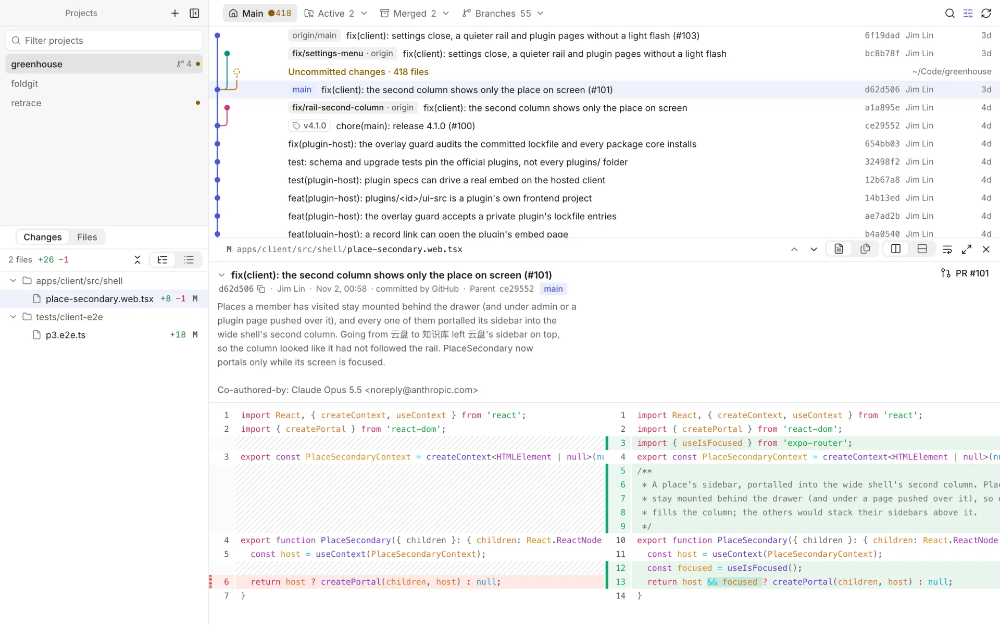
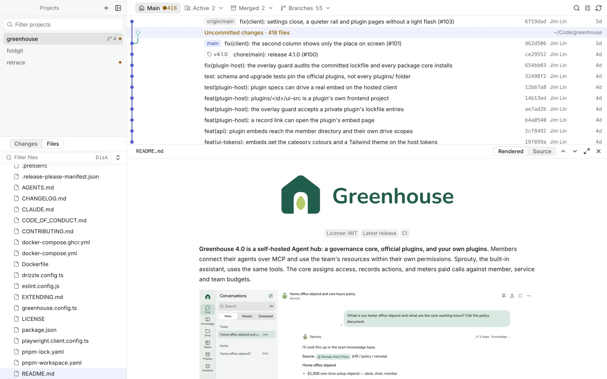

# Retrace

**A read-only desktop app for reviewing Git history across many repositories — built for the age of coding agents.**

Agents now write code in a dozen worktrees at once. Retrace puts every project, worktree and branch in one window, keeps your integration branch pinned to the left of the commit graph, and lets you read each commit's message and diff, or browse the code as it was at any commit. It never commits, stages, merges or rebases.

[中文说明](README.zh-CN.md)

<p align="center">
  
</p>

## Features

- **Many repositories, one window.** Add repositories, or a folder of them. A dot marks projects with uncommitted work; drag to reorder.
- **The integration branch stays left.** `main` (or whatever you pick) owns column 0 of a compact one-line graph. Other branches join only when you ask, local first, remote optionally.
- **Worktrees, folded.** The main tree, then *Active* (uncommitted work, or commits not yet in `main`), *Merged* (clean and already in `main`) and *Branches* without a worktree. Merged worktrees can be removed safely: no `--force`, every tree checked again first, branches deleted only with `git branch -d`.
- **Commits as you'd review them.** Click a row to open its message and diff below the graph; click it again to close. The body is shown in full (fold it if you like), and squash or merge commits get a **PR #N** button that opens the pull request on GitHub.
- **Diffs that read well.** Side by side by default, no wrapping, syntax highlighted off the main thread. Read one file at a time or every change in a row. Changed images show before and after.
- **Browse any version.** Switch *Changes* to *Files* to see the whole tree at the selected commit (or on disk for uncommitted work): filter, fold, and preview code, images, and Markdown rendered like GitHub with its relative links and images.
- **Your layout.** Drag any view's grip to dock it on another view's edge or swap them. Each view keeps a minimum size, so nothing gets squeezed.
- **A proper Mac app.** Native menu bar, keyboard first, light and dark, English and Chinese.

| | |
| --- | --- |
|  |  |
| Worktrees in progress, folded into one menu | Any version's files, Markdown rendered |
|  |  |
| Changed images, before and after | Dark theme |

## Read-only by design

Every git call runs with `GIT_OPTIONAL_LOCKS=0`, so Retrace never takes the `index.lock` an agent is using. Changes are listed with plumbing (`diff-tree`, `diff-index`) that doesn't touch the index, and squash-merge detection writes its scratch objects outside the repository.

There are exactly two writes:

- `git fetch`, which only updates remote-tracking branches (turn it off in Settings);
- removing merged worktrees, only after you confirm.

## Install

Retrace runs on macOS 13 or later and uses the `git` on your machine. Windows support is planned.

Download the `.dmg` for Apple silicon or Intel from [Releases](../../releases), or build it from source (below): `pnpm tauri build` produces `Retrace.app` and a `.dmg`. Until releases are signed and notarised, macOS asks you to confirm the first launch (right-click the app → Open).

## Keyboard

| Key | Action |
| --- | --- |
| ↑ ↓ / j k | Previous / next commit; in the file list, previous / next file |
| → / Enter | From a commit into its changes, opening the diff |
| ← | Back to the graph |
| F | Focus: only the changes and the diff |
| Esc | Leave focus → close the diff → clear the filter |
| ⌘J | Show / hide the diff |
| ⌘F | Filter commits |
| ⌘R | Refresh and fetch |
| ⌘\\ | Show / hide the projects |
| ⌘O | Add a project |
| ⇧⌘F / ⌃\` / ⇧⌘A | Open the current worktree in Finder / Terminal / your editor |
| ⌘, | Settings |

## Development

Needs Rust, Node 22 and pnpm.

```bash
pnpm install
pnpm tauri dev                 # the desktop app
```

For UI work a browser is enough: the dev bridge serves the same commands on `127.0.0.1:5198` and Vite proxies `/api` to it.

```bash
cargo run --manifest-path src-tauri/Cargo.toml --bin retrace-devbridge
pnpm dev                       # http://localhost:1420
```

`RETRACE_CONFIG_DIR=/tmp/retrace-dev` points the app and the bridge at a throwaway config instead of your project list (`~/Library/Application Support/me.jimlin.retrace/config.json`).

### Checks

```bash
cargo test --manifest-path src-tauri/Cargo.toml   # lane layout, parsing, end-to-end scenarios in temporary repositories
pnpm test                                         # layout model, file tree, translations, design guards
pnpm typecheck
pnpm tauri build                                  # Retrace.app and a .dmg
```

### Where things are

```text
src-tauri/src/core/      git (read-only environment), repositories and worktrees, lanes, history,
                         changes and file contents, the command table, backend messages (i18n.rs)
src-tauri/src/watch.rs   watches the open project's .git and working tree; periodic fetch
src-tauri/src/bin/       the dev bridge
src/components/app/      the four views: projects, changes / files, graph, diff / preview
src/components/layout/   the dockable tiled layout (model in src/lib/layout.ts)
src/lib/commands.ts      commands shared by the menu bar, shortcuts and buttons; menu.ts builds the menu bar
src/lib/i18n.ts          UI language: English source strings, Chinese in src/locales/zh.ts
src/components/ui/       jim-uiux components, installed from its registry
```

### Releasing

Push a tag such as `v0.4.0`: the Release workflow builds both architectures and attaches them to a draft release. To sign and notarise, add the repository secrets `APPLE_CERTIFICATE` (a base64 Developer ID Application certificate), `APPLE_CERTIFICATE_PASSWORD`, `APPLE_SIGNING_IDENTITY`, `APPLE_ID`, `APPLE_PASSWORD` (an app-specific password) and `APPLE_TEAM_ID`.

## License

[MIT](LICENSE). Contributions welcome — see [CONTRIBUTING.md](CONTRIBUTING.md).

Built with [Tauri](https://tauri.app), React, [@pierre/diffs](https://www.npmjs.com/package/@pierre/diffs) and [react-markdown](https://github.com/remarkjs/react-markdown). The interface follows [jim-uiux](https://design.linjiejim.com).
