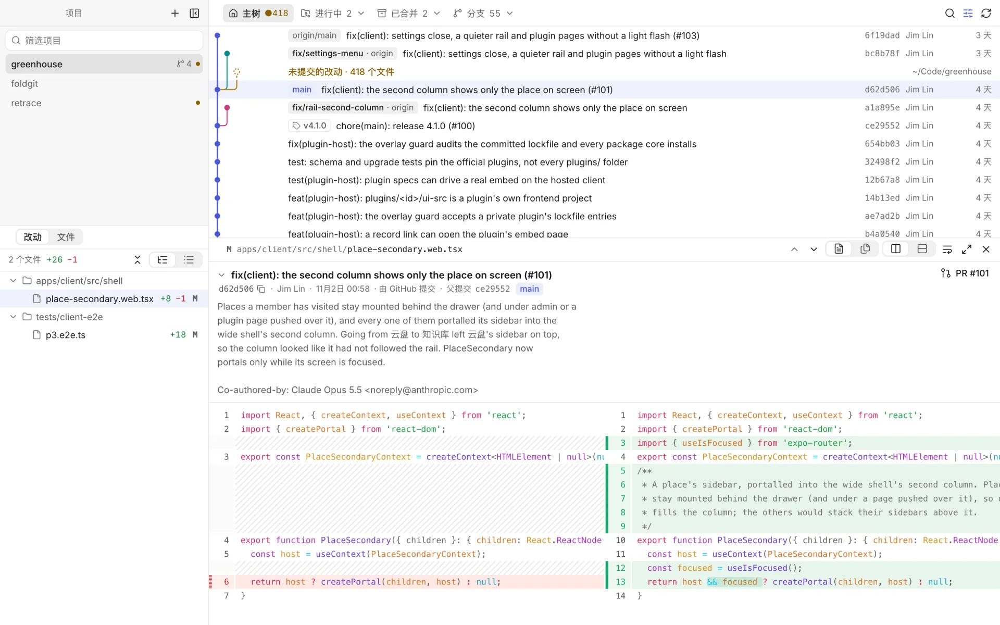
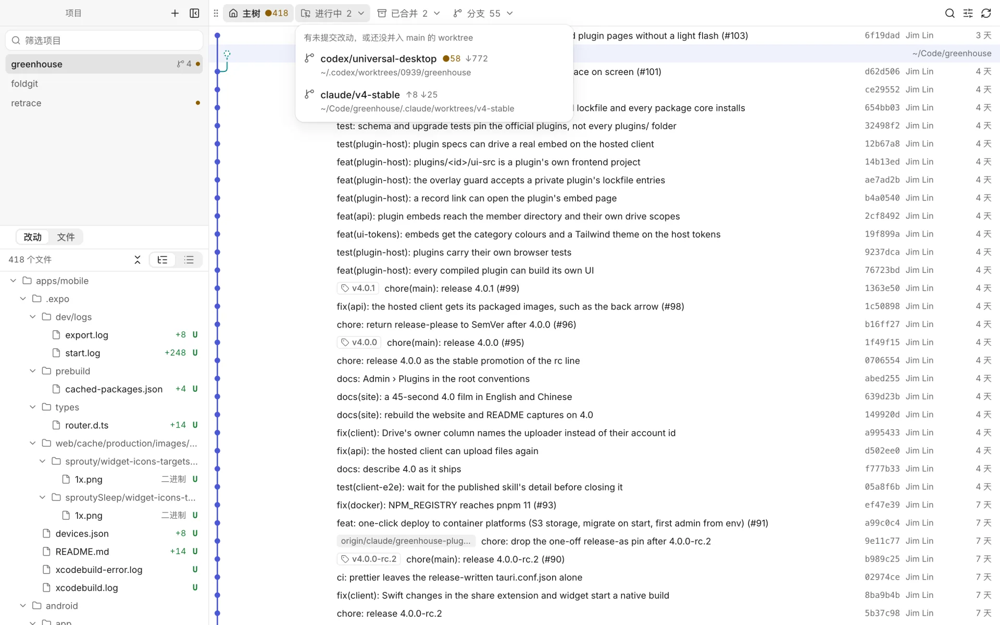
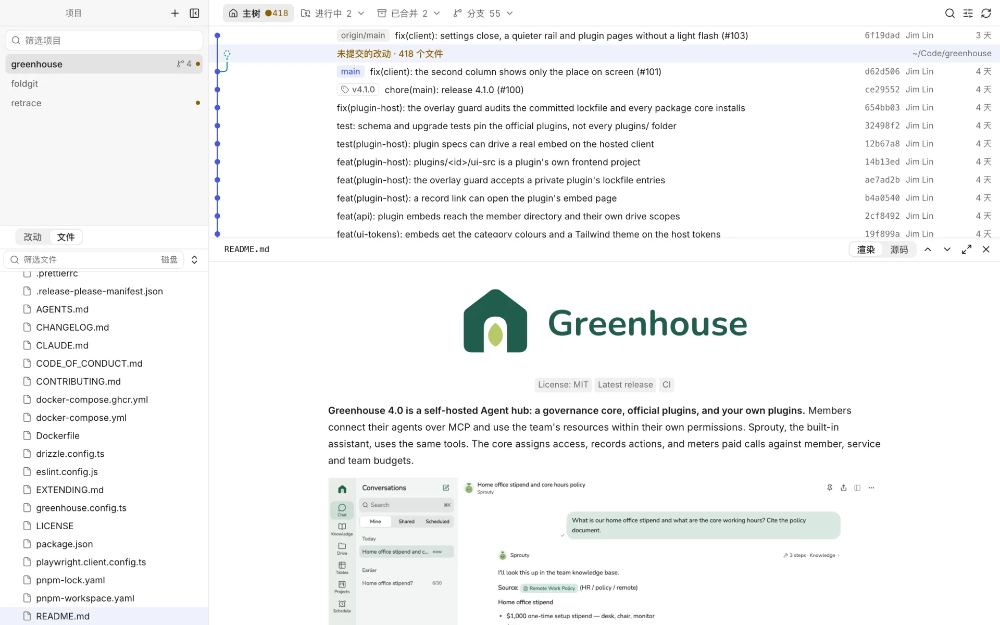
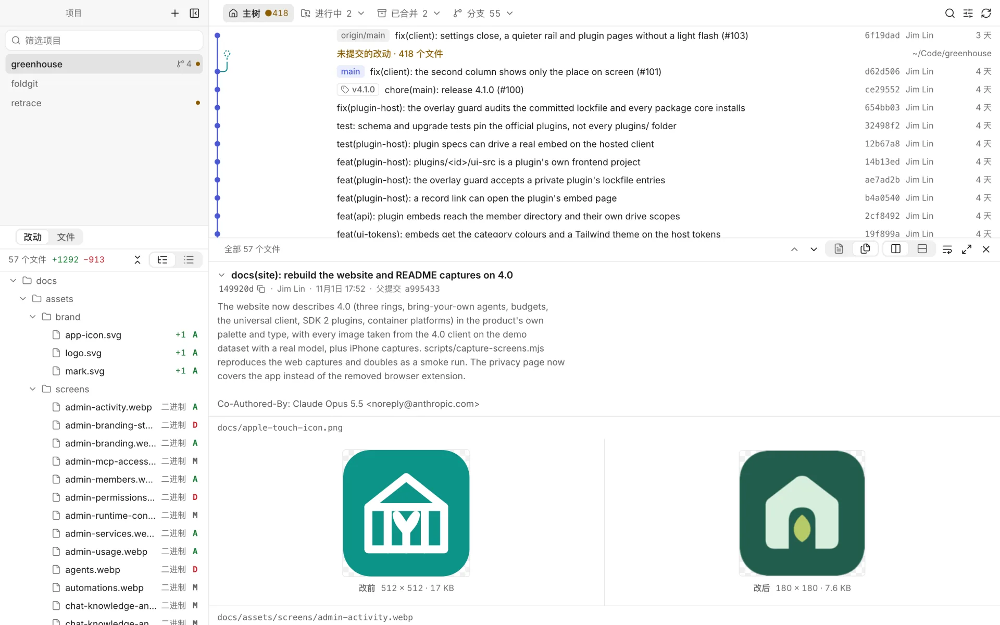
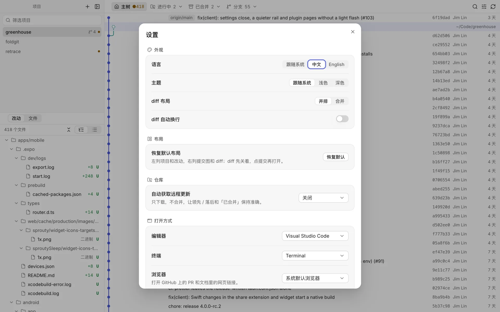

# Retrace

**只读的多仓库 Git 历史审查与复盘工具，给 coding agent 时代用的桌面 App。**

agent 会同时在十几棵 worktree 里写代码。Retrace 把所有项目、worktree 和分支放在一个窗口里，集成分支固定在提交图最左列；点一个提交就能看它的说明和 diff，也能按任一提交浏览当时的代码。它不提交、不暂存、不合并、不变基。

[官网](https://retrace.linjiejim.com) · [下载](../../releases/latest) · [English](README.md)

<p align="center">
  
</p>

## 特点

- **多个仓库，一个窗口。** 添加仓库，或一个装着仓库的文件夹。有未提交改动的项目带小圆点，拖动可以排序，也可以分组、折叠。项目和分组都能右键打开菜单。
- **集成分支永远在最左列。** `main`（或你指定的分支）占提交图第 0 列，提交图单行紧凑。其他分支按需加上，先本地，可再勾选远程。
- **worktree 和分支收纳好。** 主树之外分成「进行中」（有未提交改动或还没并入 main）、「已合并」（干净且已并入 main 的 worktree 和本地分支，squash 合并的也算）、「分支」（没有 worktree、还在进行中）。已合并的可以安全删除：不加 `--force`，删前逐项复查，分支只在仍指向你看到的那个提交时才删，删完可以马上撤销。`develop`、`release/*` 和你设为保留的分支不会列进来。
- **按审查的方式看提交。** 点提交行，在提交图下方打开说明和 diff，再点一次收起。正文默认完整显示（可折叠并记住）；squash 合并或 merge 提交会出现「PR #N」，一键打开 GitHub 上的 PR。
- **好读的 diff。** 默认并排、不换行，语法高亮在后台线程里做；可以一个文件一个文件看，也可以连续阅读整个提交。图片改动显示改前改后。
- **浏览任一版本。** 把「改动」切到「文件」，看选中提交时的整个目录（未提交的改动就是磁盘上的文件）：筛选、折叠，预览代码、图片，Markdown 像 GitHub 一样渲染，相对链接和图片都能用。点开一个文件，提交图就只列改过它的提交，可以逐个看它每次的改动。文件图标有四套主题（设置 → 文件图标）。
- **布局随你。** 拖动视图左上角的把手，停靠到别的视图四边或交换位置；每块视图都有最小尺寸，挤不坏。
- **像样的 Mac App。** 原生菜单栏，键盘优先，浅色 / 深色，中文 / 英文。

| | |
| --- | --- |
|  |  |
| 进行中的 worktree 收在一个下拉里 | 任一版本的文件，Markdown 渲染 |
|  |  |
| 图片改动，改前改后 | 设置 |

## 只读约定

所有 git 调用都带 `GIT_OPTIONAL_LOCKS=0`，不抢 agent 正在用的 `index.lock`；列改动只用 `diff-tree` / `diff-index` 这类不碰 index 的命令；判断 squash 合并时的临时对象写在仓库外面。

写操作只有两个：

- `git fetch`：只更新远程分支，可在设置里关掉；
- 删除已合并的 worktree 和本地分支：只在你确认后执行（以及撤销时恢复刚删的分支）。勾选后，删掉的分支在 origin 上的那一份也一起删（`git push origin :<分支>`，带 `--force-with-lease`），前提是 origin 上仍是上次 fetch 看到的提交、而且提交都已在主干里。

## 安装

macOS 13 及以上，使用本机的 `git`。Windows 以后补。

在 [Releases](../../releases) 下载 Apple 芯片或 Intel 的 `.dmg`，或从源码构建（见下方）：`pnpm tauri build` 产出 `Retrace.app` 和 `.dmg`。

发布的版本还没有经过 Apple 公证，第一次打开时 macOS 可能提示「已损坏」或「无法验证」。把 Retrace 拖进「应用程序」后，到「系统设置 → 隐私与安全性」点「仍要打开」，或运行 `xattr -dr com.apple.quarantine /Applications/Retrace.app`。

之后 Retrace 会从 GitHub Releases 自动更新：启动时和之后每隔几小时查看最新版本，在后台下载，用 App 内置的签名公钥校验后装好，再提示你重启。在「设置 → 更新」里可以关掉，也可以用「Retrace → 检查更新…」马上查一次。0.5.0 及更早的版本还没有这个功能，需要手动下载一次新版本。

## 快捷键

| 快捷键 | 作用 |
| --- | --- |
| ↑ ↓ / j k | 上一个 / 下一个提交；在改动或文件列表里是上一个 / 下一个文件 |
| → / Enter | 从提交进入改动，打开 diff |
| ← | 回到提交图 |
| F | 专注：只留改动和 diff |
| Esc | 退出专注 → 关闭 diff → 清空筛选 |
| ⌘J | 打开 / 关闭 diff |
| ⌘F | 筛选提交 |
| ⌘R | 刷新并从远程获取 |
| ⌘\\ | 收起 / 展开项目栏 |
| ⌘O | 添加项目 |
| ⇧⌘F / ⌃\` / ⇧⌘A | 在 Finder / 终端 / 编辑器打开当前 worktree |
| ⌘, | 设置 |

## 开发

需要 Rust、Node 22、pnpm。

```bash
pnpm install
pnpm tauri dev                 # 桌面 App
```

只调界面时可以用浏览器：开发桥把同一套命令挂在 `127.0.0.1:5198`，Vite 把 `/api` 代理过去。

```bash
cargo run --manifest-path src-tauri/Cargo.toml --bin retrace-devbridge
pnpm dev                       # http://localhost:1420
```

`RETRACE_CONFIG_DIR=/tmp/retrace-dev` 可以让 App 和开发桥用一份临时配置，不碰真实的项目列表（默认在 `~/Library/Application Support/me.jimlin.retrace/config.json`）。

### 检查

```bash
cargo test --manifest-path src-tauri/Cargo.toml   # 车道算法、解析、临时仓库里的端到端场景
pnpm test                                         # 布局模型、改动树、翻译完整性、设计守卫
pnpm typecheck
pnpm tauri build                                  # 产出 Retrace.app 和 dmg
```

### 代码在哪

```text
src-tauri/src/core/      git 调用（只读环境）、仓库与 worktree、车道算法、历史、改动与文件内容、命令分发、后端提示语言（i18n.rs）
src-tauri/src/watch.rs   监听当前项目的 .git 和工作区；定时 fetch
src-tauri/src/bin/       开发桥
src/components/app/      四块视图：项目、改动 / 文件、提交图、diff / 预览
src/components/layout/   可拖动停靠的平铺布局（模型在 src/lib/layout.ts）
src/lib/commands.ts      菜单栏、快捷键和按钮共用的命令；menu.ts 是 macOS 菜单栏
src/lib/i18n.ts          界面语言：代码里写英文原文，中文在 src/locales/zh.ts
src/components/ui/       jim-uiux 组件（从 registry 安装）
site/                    官网（retrace.linjiejim.com）：纯 HTML、CSS、JS，Site 工作流部署
```

### 发布

推一个 `v0.4.0` 这样的 tag，Release 工作流会构建两种架构，连同签好名的更新包和更新清单 `latest.json` 一起挂到一个草稿 release 上。发布草稿才算真正推送更新：已安装的 App 只读最新一个已发布 release 里的 `latest.json`。更新签名需要仓库 secret `TAURI_SIGNING_PRIVATE_KEY`：`tauri.conf.json` 里 `plugins.updater.pubkey` 对应的那把私钥（无密码）。私钥要另存一份：已安装的 App 只接受这把钥匙签的更新，换钥匙就得换 `pubkey`，所有人都要手动下载一次。写 `latest.json` 之前，工作流会用这把公钥校验两个更新包，并核对 tag 和 `tauri.conf.json` 里的版本号是否一致。要签名和公证，在仓库 secrets 里加 `APPLE_CERTIFICATE`（base64 的 Developer ID Application 证书）、`APPLE_CERTIFICATE_PASSWORD`、`APPLE_SIGNING_IDENTITY`、`APPLE_ID`、`APPLE_PASSWORD`（App 专用密码）和 `APPLE_TEAM_ID`。

## 致谢

Retrace 受到以下项目的启发：

- [Git Graph](https://marketplace.visualstudio.com/items?itemName=mhutchie.git-graph)，VS Code 扩展：在代码旁边把历史当成一张图来读。
- [FoldGit](https://foldgit.com/)：多个仓库收在一个窗口里，worktree 挂在各自的仓库下面。

## 许可证

[MIT](LICENSE)。欢迎贡献，见 [CONTRIBUTING.md](CONTRIBUTING.md)。

基于 [Tauri](https://tauri.app)、React、[@pierre/diffs](https://www.npmjs.com/package/@pierre/diffs)、[react-markdown](https://github.com/remarkjs/react-markdown)；界面遵循 [jim-uiux](https://design.linjiejim.com)。
